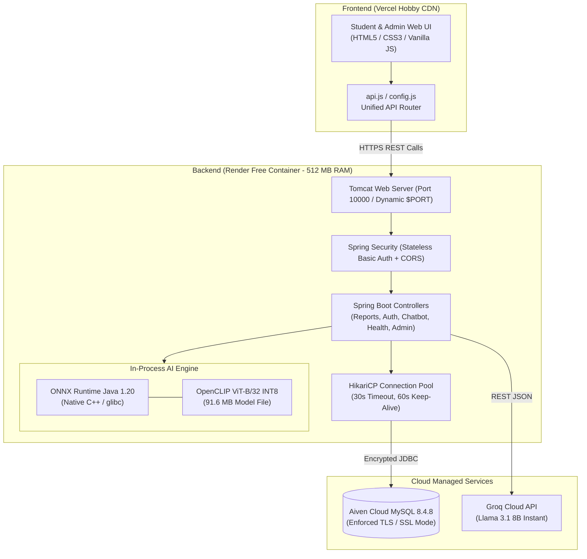

# CampusFind AI — AI-Powered Campus Lost & Found System

[](https://campusfindai-static.vercel.app/)
[](https://campusfind-backend-wary.onrender.com/)
[](https://campusfind-backend-wary.onrender.com/api/v1/health)
[](https://adoptium.net/)
[](https://spring.io/projects/spring-boot)
[](https://onnxruntime.ai/)
[](https://aiven.io/)

---

## 📌 1. Project Overview & Objectives

**CampusFind AI** is a modern, full-stack campus Lost and Found management platform engineered for universities and educational institutions. On crowded campuses, misplaced items—such as smartphones, student ID cards, laptops, keys, and backpacks—often go unclaimed because traditional keyword-based bulletin boards fail when users describe items differently (e.g., searching for *"black phone"* when the finder reported *"iPhone 13 with dark silicone cover"*).

CampusFind AI resolves this challenge by introducing **in-process visual similarity search powered by OpenCLIP ViT-B/32 INT8 ONNX**. When a lost or found report is submitted with an image, the system automatically generates a 512-dimensional semantic embedding vector and mathematically ranks candidate matches in real time using cosine similarity.

### Key Objectives
* **Visual Search Beyond Keywords**: Match lost items against found items using neural image embeddings, regardless of phrasing differences.
* **Autonomous AI Assistance**: Provide an interactive student help assistant powered by Groq's low-latency Llama 3.1 LLM to guide users through report creation, searching tips, and campus claim policies.
* **Zero-Budget Production Hosting (₹0 / Month)**: Engineered to operate permanently within the free tiers of Render (Spring Boot + ONNX), Vercel (static frontend), and Aiven (managed cloud MySQL).
* **Enterprise Security & Data Integrity**: Role-Based Access Control (`ROLE_STUDENT`, `ROLE_ADMIN`), BCrypt password encryption, stateless HTTP Basic authentication, and safe Hibernate schema validation.

---

## 🌐 2. Live Deployment URLs

| Component | Platform | URL | Purpose |
| :--- | :--- | :--- | :--- |
| **Frontend UI** | **Vercel Hobby** | [https://campusfindai-static.vercel.app/](https://campusfindai-static.vercel.app/) | Responsive student & admin web application |
| **Backend API** | **Render Free** | [https://campusfind-backend-wary.onrender.com/](https://campusfind-backend-wary.onrender.com/) | Spring Boot REST API & In-Process ONNX AI Engine |
| **System Health** | **Render Free** | [https://campusfind-backend-wary.onrender.com/api/v1/health](https://campusfind-backend-wary.onrender.com/api/v1/health) | Live persistence and service health check |
| **Database** | **Aiven Free** | Managed Cloud MySQL 8.4.8 | Cloud persistence with enforced TLS encryption |

---

## ⚡ 3. Features & Functionality

* 🔍 **Smart Item Reporting**: Submit Lost and Found reports with category selection, date/time, campus location, item description, and image attachment.
* 🤖 **In-Process OpenCLIP AI Matching**:
  * Extracts 512-dimensional visual embedding vectors on report creation.
  * Calculates ranked candidate matches using cosine similarity against complementary items (`LOST` vs. `FOUND`).
  * Runs embedded inside Java via Microsoft ONNX Runtime—eliminating the latency, cost, and complexity of separate Python microservices.
* 💬 **Groq AI Help Assistant**: Context-aware campus chatbot answering student queries about claim locations, report statuses, and lost item procedures.
* 🛡️ **Role-Based Access Control (RBAC)**:
  * **Students**: Register, log in, create reports, view candidate AI matches, update status (`RESOLVED`, `CANCELLED`), and delete own reports.
  * **Administrators**: Dedicated admin console to oversee campus-wide reports, inspect users, and manage items.
* 📊 **Resilient Health Probes**:
  * `/api/v1/health` with non-blocking background pre-warming and a 5-second TTL cache to prevent probe CPU starvation.
* 💾 **Dual-Mode Persistence**:
  * **Cloud Mode**: Connects to TLS-encrypted Aiven MySQL 8.4.8 with Hibernate `validate` mode.
  * **Local Development Mode**: Falls back to an embedded persistent H2 database (`./data/campusfinddb`) for instant offline execution without external database setup.

---

## 🛠️ 4. Technology Stack

### Backend
* **Language & Framework**: Java 21 LTS, Spring Boot 4.0.8
* **Persistence & ORM**: Spring Data JPA, Hibernate ORM 7.2.24
* **Security**: Spring Security with BCrypt password hashing & HTTP Basic authentication
* **Connection Pooling**: HikariCP (configured for cloud NAT keep-alives and 30s connection timeout)
* **Build Tool**: Apache Maven 3.9+ with Maven Wrapper (`./mvnw`)

### Artificial Intelligence & Machine Learning
* **Visual Encoder**: OpenCLIP ViT-B/32 (INT8 Quantized, ~91.6 MB model footprint)
* **Inference Runtime**: Microsoft ONNX Runtime Java (`com.microsoft.onnxruntime:onnxruntime:1.20.0`)
* **Vector Matching**: In-process Cosine Similarity calculation with configurable similarity threshold (default: `0.60`)
* **Large Language Model**: Groq Cloud API (`llama-3.1-8b-instant`) for student assistant chat completions

### Frontend
* **Core**: Modern Semantic HTML5, Vanilla JavaScript (ES6+ Modules & Fetch API)
* **Styling**: Vanilla CSS3 with mobile-responsive flexbox/grid layout and glassmorphism accents
* **Deployment Routing**: Unified API proxy configuration via `vercel.json` rewrites and automated origin detection (`config.js`)

### Database & Infrastructure
* **Production Database**: Aiven Cloud MySQL 8.4.8 Free Tier (SSL Required)
* **Local Database**: Eclipse H2 Database 2.4.240
* **Containerization**: Multi-stage Docker build with Eclipse Temurin 21 JRE base image

---

## 🏗️ 5. Architecture & System Flow



---

## 📂 6. Project Folder Structure

```text
CampusFindai/
├── .gitignore                               # Git ignore configuration
├── CAMPUSFIND_DEPLOYMENT_GUIDE.md           # Step-by-step production deployment manual
├── CAMPUSFIND_PRODUCTION_READINESS_REPORT.md# Technical readiness audit report
├── README.md                                # Root project documentation
├── render.yaml                              # Render Infrastructure as Code Blueprint
├── vercel.json                              # Vercel CDN routing and API rewrite rules
│
└── campusfind-backend/                      # Spring Boot Java Application
    ├── Dockerfile                           # Multi-stage container definition (glibc Temurin JRE)
    ├── .dockerignore                        # Docker build exclusion rules
    ├── pom.xml                              # Maven build file and dependencies
    ├── mvnw / mvnw.cmd                      # Cross-platform Maven wrapper scripts
    │
    ├── models/
    │   └── openclip_vit_b32_int8.onnx       # Bundled INT8 visual embedding model (91.6 MB)
    │
    ├── src/
    │   ├── main/
    │   │   ├── java/com/campusfind/
    │   │   │   ├── CampusfindBackendApplication.java # Spring Boot entrypoint
    │   │   │   ├── config/                  # Security, CORS, AI, and Admin Bootstrap configurations
    │   │   │   ├── controller/              # REST Controllers (Auth, Reports, Chatbot, Health, Admin)
    │   │   │   ├── dto/                     # Request and Response Data Transfer Objects
    │   │   │   ├── entity/                  # JPA Database Entities (User, ItemReport, Enums)
    │   │   │   ├── exception/               # Global REST exception handlers
    │   │   │   ├── repository/              # Spring Data JPA Repositories
    │   │   │   └── service/                 # Business logic, Local ONNX inference, Chatbot, Health
    │   │   │
    │   │   └── resources/
    │   │       ├── application.properties   # Application configuration and environment variable bindings
    │   │       └── static/                  # Responsive web frontend (served locally and deployed to Vercel)
    │   │           ├── index.html           # Landing page
    │   │           ├── browse.html          # Lost & found item catalog with filters
    │   │           ├── create-report.html   # Report submission with image upload
    │   │           ├── detail.html          # Report inspection and candidate match viewer
    │   │           ├── login.html           # Student & Admin login
    │   │           ├── register.html        # Account registration
    │   │           ├── admin.html           # Administrator moderation dashboard
    │   │           ├── css/style.css        # Main stylesheet
    │   │           └── js/                  # Frontend scripts (api.js, auth.js, config.js, app.js)
    │   │
    │   └── test/
    │       ├── java/com/campusfind/         # 102 automated JUnit 5 / SpringBootTest test cases
    │       └── javascript/                  # 7 automated Node.js frontend unit tests
```

---

## 🔑 7. Required Environment Variables

To protect sensitive credentials, all passwords and API keys are strictly driven by environment variables. **Never commit secret values to version control.**

| Environment Variable | Description | Example / Allowed Values | Default (if unset) |
| :--- | :--- | :--- | :--- |
| `PORT` | Container listening port (Render automatically supplies `10000`) | `8080`, `10000` | `8080` |
| `SPRING_PROFILES_ACTIVE` | Active Spring profile | `default`, `aiven`, `test` | `aiven` |
| `SPRING_DATASOURCE_URL` | JDBC database connection URL | `jdbc:mysql://<host>:<port>/<dbname>?sslMode=REQUIRED` | Persistent local H2 (`./data/campusfinddb`) |
| `SPRING_DATASOURCE_USERNAME` | Database username | `avnadmin`, `sa` | `sa` |
| `SPRING_DATASOURCE_PASSWORD` | Database password | *`<your-secure-password>`* | *(empty)* |
| `SPRING_DATASOURCE_DRIVER_CLASS_NAME` | JDBC Driver class name | `com.mysql.cj.jdbc.Driver` | `org.h2.Driver` |
| `SPRING_JPA_HIBERNATE_DDL_AUTO` | Hibernate schema management mode | `validate`, `update`, `none` | `validate` |
| `CAMPUSFIND_AI_ONNX_ENABLED` | Enable in-process ONNX AI matching | `true`, `false` | `true` |
| `CAMPUSFIND_AI_MODEL_PATH` | Path to the ONNX model file | `models/openclip_vit_b32_int8.onnx` | `models/openclip_vit_b32_int8.onnx` |
| `CAMPUSFIND_AI_CONCURRENCY_LIMIT`| Maximum concurrent AI inference operations | `1` to `4` | `3` |
| `CAMPUSFIND_CORS_ALLOWED_ORIGINS`| Allowed CORS frontend origins | `https://*.vercel.app,http://localhost:8080` | `https://*.vercel.app` *(localhost auto-allowed)* |
| `GROQ_API_KEY` | Groq Cloud API authorization key | `gsk_...` | *(empty — chatbot returns graceful fallback)* |
| `GROQ_MODEL_ID` | Groq chat model identifier | `llama-3.1-8b-instant` | `llama-3.1-8b-instant` |
| `GROQ_API_URL` | Groq completions API endpoint | `https://api.groq.com/openai/v1/chat/completions` | Groq OpenAI endpoint |
| `CAMPUSFIND_ADMIN_EMAIL` | Default system administrator email | `admin@campus.edu` | *(bootstrap skipped if empty)* |
| `CAMPUSFIND_ADMIN_PASSWORD` | Default system administrator password | *`<your-secure-password>`* | *(bootstrap skipped if empty)* |
| `CAMPUSFIND_ADMIN_NAME` | Administrator display name | `System Administrator` | `System Administrator` |
| `CAMPUSFIND_ADMIN_RESET_PASSWORD` | Force reset of administrator password on boot | `false`, `true` | `false` |

---

## 💻 8. Local Installation & Setup

### Prerequisites
* **Java Development Kit (JDK) 21 LTS** installed and configured (`java -version`).
* **Git** installed (`git --version`).
* **Maven 3.9+** (optional; the repository includes `./mvnw` wrapper).
* **Node.js 18+** (optional; needed only to execute frontend unit tests).

### Quick Start (Zero-Configuration Local Run)

By default, CampusFind AI starts with an embedded file-based H2 database in `./data/campusfinddb`. No external MySQL installation is needed to test locally.

1. **Clone the repository**:
   ```bash
   git clone https://github.com/AdithyaVardhan2020/CampusFindai.git
   cd CampusFindai/campusfind-backend
   ```

2. **Build the application**:
   ```bash
   ./mvnw clean package -DskipTests
   ```
   *(On Windows Command Prompt or PowerShell, use `mvnw.cmd clean package -DskipTests`)*

3. **Run Spring Boot locally**:
   ```bash
   ./mvnw spring-boot:run
   ```

4. **Access the application**:
   * Open your web browser and navigate to: `http://localhost:8080`
   * Health Check: `http://localhost:8080/api/v1/health`
   * H2 Web Console: `http://localhost:8080/h2-console` (JDBC URL: `jdbc:h2:file:./data/campusfinddb`, User: `sa`, Password: *(blank)*)

---

## 🚀 9. Production Deployment Guide

### A. Deploy Backend to Render Free
1. Fork or push this repository to GitHub.
2. Sign in to [Render Dashboard](https://dashboard.render.com/) and click **New +** > **Web Service**.
3. Connect repository `AdithyaVardhan2020/CampusFindai`.
4. Configure service settings:
   * **Name**: `campusfind-backend`
   * **Region**: Oregon (US West) or Frankfurt
   * **Branch**: `master`
   * **Root Directory**: `campusfind-backend`
   * **Runtime**: `Docker`
   * **Plan**: `Free`
5. In **Environment Variables**, provide:
   * `SPRING_DATASOURCE_URL`: Your Aiven MySQL JDBC connection string with `?sslMode=REQUIRED`
   * `SPRING_DATASOURCE_USERNAME`: Your Aiven database username
   * `SPRING_DATASOURCE_PASSWORD`: Your Aiven database password
   * `SPRING_DATASOURCE_DRIVER_CLASS_NAME`: `com.mysql.cj.jdbc.Driver`
   * `SPRING_JPA_HIBERNATE_DDL_AUTO`: `validate`
   * `GROQ_API_KEY`: Your Groq Cloud API key
   * `CAMPUSFIND_ADMIN_EMAIL` & `CAMPUSFIND_ADMIN_PASSWORD`: Your initial admin credentials
6. Click **Create Web Service**. Render builds the multi-stage Docker image, runs database validation, loads OpenCLIP INT8, and starts listening on dynamic `$PORT`.

### B. Deploy Frontend to Vercel Hobby
1. Sign in to [Vercel Dashboard](https://vercel.com/) and click **Add New...** > **Project**.
2. Select your GitHub repository.
3. Configure the project:
   * **Root Directory**: Select `campusfind-backend/src/main/resources/static`
   * **Framework Preset**: `Other`
4. Click **Deploy**. Vercel will deploy the static site globally in seconds.
5. Requests to `/api/v1/*` are automatically proxied to the live Render backend via [vercel.json](file:///d:/CampusFindai/vercel.json).

---

## 📡 10. API Documentation

All API endpoints are prefixed with `/api/v1`. Authentication uses standard **HTTP Basic Authentication** (`Authorization: Basic base64(email:password)`).

### Authentication & User Management

| Method | Endpoint | Access | Request Body | Description |
| :--- | :--- | :--- | :--- | :--- |
| `POST` | `/api/v1/auth/register` | Public | JSON (`name`, `email`, `password`, `phone`) | Registers a new student account. Password is encrypted with BCrypt. |
| `GET` | `/api/v1/auth/me` | Authenticated | None | Returns profile metadata for the authenticated user. |

### Item Reports & AI Matching

| Method | Endpoint | Access | Request Body | Description |
| :--- | :--- | :--- | :--- | :--- |
| `GET` | `/api/v1/reports` | Authenticated | None *(Optional query params: `type=LOST\|FOUND`, `status=OPEN\|RESOLVED`)* | Retrieves a filtered or complete list of campus item reports. |
| `POST` | `/api/v1/reports` | Authenticated | JSON (`title`, `description`, `category`, `type`, `location`, `dateTime`, `imageBase64`) | Creates a new report and computes its 512-d OpenCLIP embedding. |
| `GET` | `/api/v1/reports/{id}` | Authenticated | None | Retrieves complete details for a specific item report. |
| `PATCH`| `/api/v1/reports/{id}/status` | Author / Admin| JSON (`status`: `OPEN`, `RESOLVED`, `CANCELLED`) | Updates the lifecycle status of an item report. |
| `DELETE`|`/api/v1/reports/{id}` | Author / Admin| None | Removes an item report. |
| `GET` | `/api/v1/reports/{id}/matches` | Authenticated | None | Ranks candidate matches for report `{id}` using cosine similarity. |
| `POST` | `/api/v1/reports/{id}/embedding` | Authenticated | JSON (`image_base64` or `embedding`) | Manually generates or updates the visual embedding vector. |
| `GET` | `/api/v1/reports/ai-health` | Authenticated | None | Checks the diagnostic operational status of the ONNX AI engine. |

### AI Help Chatbot

| Method | Endpoint | Access | Request Body | Description |
| :--- | :--- | :--- | :--- | :--- |
| `POST` | `/api/v1/chatbot/message` | Public | JSON (`message`: string, `history`: array) | Communicates with the Groq Llama 3.1 chatbot for campus lost & found support. |

### Health & Monitoring

| Method | Endpoint | Access | Request Body | Description |
| :--- | :--- | :--- | :--- | :--- |
| `GET` | `/api/v1/health` | Public | None | Returns HTTP 200 `UP` with database product version, catalog, and connectivity health. |

### Administrator Endpoints

| Method | Endpoint | Access | Request Body | Description |
| :--- | :--- | :--- | :--- | :--- |
| `GET` | `/api/v1/admin/users` | `ROLE_ADMIN` | None | Lists all registered user accounts and roles across the system. |
| `DELETE`|`/api/v1/admin/users/{id}`| `ROLE_ADMIN` | None | Deletes a specified user account. |
| `GET` | `/api/v1/admin/reports` | `ROLE_ADMIN` | None | Lists all campus reports across all statuses and users. |

---

## 🧪 11. Testing Instructions

### Run Backend Unit & Integration Tests (102 Tests)
The Spring Boot test suite includes automated tests for security filters, authentication, controllers, database validation, ONNX embedding generation, and cosine similarity matching.

```bash
cd campusfind-backend
./mvnw test
```
*(On Windows: `mvnw.cmd test`)*

Expected result:
```text
[INFO] Results:
[INFO] Tests run: 102, Failures: 0, Errors: 0, Skipped: 0
[INFO] BUILD SUCCESS
```

### Run Frontend Unit Tests (7 Tests)
Frontend JavaScript testing validates URL resolution, session handling, XSS escaping, date formatting, and API requests using Node.js's built-in test runner:

```bash
node campusfind-backend/src/test/javascript/frontend.test.mjs
```

Expected result:
```text
✔ CampusFind Frontend Unit Tests
ℹ tests 7
ℹ pass 7
ℹ fail 0
```

---

## ⚠️ 12. Known Limitations of Free Hosting Tier

Because CampusFind AI is deployed at strictly **₹0 hosting cost**, users and evaluators should keep the following platform behaviors in mind:

1. **Render Free Inactivity Spin-Down**:
   * Render Free web services automatically spin down to sleep after **15 minutes of inactivity**.
   * When an incoming request arrives while sleeping, Render wakes the container. This initial "cold start" takes **~45 to 60 seconds**. Subsequent requests respond in milliseconds.
2. **512 MB Memory Limit**:
   * The Render Free container ceiling is strictly 512 MB RAM.
   * To prevent memory overflows, the JVM is optimized with `-XX:+UseSerialGC`, `-Xms128m -Xmx256m`, and `-XX:MaxMetaspaceSize=128m`.
   * AI inference concurrency is limited to 3 concurrent requests (`CAMPUSFIND_AI_CONCURRENCY_LIMIT=3`).
3. **0.1 vCPU CPU Throttling**:
   * The container operates with 0.1 CPU allocation.
   * Database health check pre-warming is performed asynchronously in a background daemon thread so it never delays container port detection.
4. **Aiven MySQL Free Tier**:
   * Provides 1 CPU and 1 GB storage, perfectly adequate for campus lost & found records.
   * Connections enforce TLS encryption; connection pool size is capped at 5 with a 60-second keep-alive to avoid NAT idle disconnects.

---

## 📄 License & Attribution

CampusFind AI is developed for academic and campus lost & found management.
* **OpenCLIP**: Trained by LAION, licensed under MIT.
* **ONNX Runtime**: Developed by Microsoft, licensed under MIT.
* **Spring Boot**: Developed by VMware / Broadcom, licensed under Apache 2.0.
